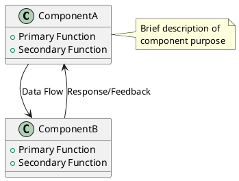
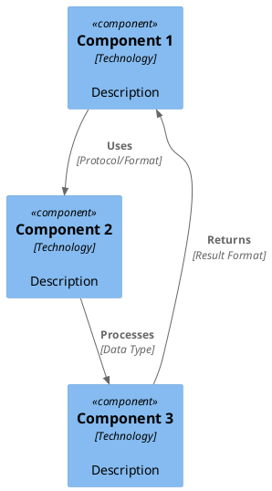

# System Architecture Description

## Document Control
- **Version**: 1.0
- **Last Updated**: [Date]

## Overview

[Provide a high-level overview of the system architecture in 2-3 paragraphs. Describe the system's purpose, main functionality, and architectural approach.]

## System Components

### Major Components

[List and describe the major subcomponents of the system]

| Component | Responsibility | Key Technologies |
|-----------|---------------|------------------|
| [Component Name] | [High-level responsibility] | [Technologies used] |
| [Component Name] | [High-level responsibility] | [Technologies used] |

### Component Interactions

[Describe how components interact and data flows between them]

## Information & Data Flow

[Describe the overall data flow through the system]

### Key Workflows

[Describe major workflows using C4 component diagram principles]

## Technology Stack

### Core Technologies

| Layer | Technology | Version | Purpose |
|-------|------------|---------|---------|
| [Frontend/Backend/Database/etc.] | [Technology Name] | [Version] | [Purpose/Role] |

### Development Tools

| Tool | Purpose |
|------|---------|
| [Tool Name] | [Description of use] |

## Dependencies

### External Dependencies

| Dependency | Version | Purpose | License |
|------------|---------|---------|---------|
| [Library/Service Name] | [Version] | [What it's used for] | [License Type] |

### Internal Dependencies

[List internal modules or services this system depends on]

## Test Strategy

### Testing Approach

- **Unit Tests**: [Description of unit testing approach and coverage expectations]
- **Integration Tests**: [Description of integration testing strategy]
- **End-to-End Tests**: [Description of E2E testing approach]
- **Performance Tests**: [Description of performance testing/benchmarking strategy]

### Test Infrastructure

| Component | Tool/Framework | Purpose |
|-----------|----------------|---------|
| Unit Testing | [Framework] | [Description] |
| Integration Testing | [Framework] | [Description] |
| CI/CD | [Platform] | [Description] |

### Coverage and Quality Gates

- **Minimum Coverage**: [Percentage]%
- **Quality Gates**: [Description of quality requirements]
- **Automated Testing**: [Description of CI automation]

## Deployment Architecture

[Describe how the system is deployed, including environments and infrastructure]

### Environments

| Environment | Purpose | URL/Access |
|-------------|---------|------------|
| Development | [Purpose] | [Access method] |
| Staging | [Purpose] | [Access method] |
| Production | [Purpose] | [Access method] |

### Infrastructure

[Describe infrastructure requirements and setup]

## Security Considerations

[Describe security measures, authentication, authorization, and data protection approaches]

## Performance Characteristics

[Describe expected performance characteristics, scalability considerations, and bottlenecks]

## Monitoring and Observability

[Describe monitoring, logging, and observability strategy]

## Future Considerations

[Brief notes on known limitations, planned improvements, or architectural evolution plans]
