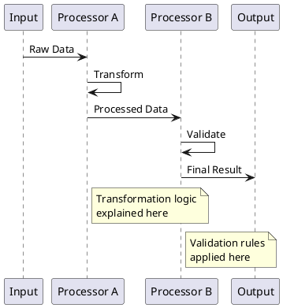
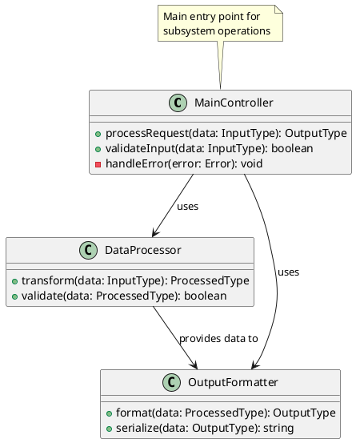
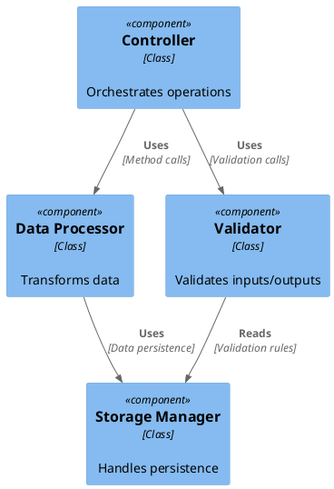
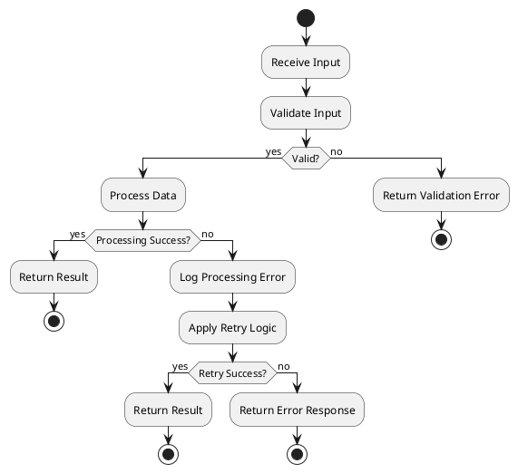

# [Subsystem Name] - System Design Description

## Document Control
- **Version**: 1.0
- **Last Updated**: [Date]

## Overview

[Provide a clear description of this subsystem's role within the larger system architecture. Explain why this subsystem exists and its importance to the overall system.]

## Responsibilities

### Primary Responsibilities

- **[Responsibility 1]**: [Detailed description of what the subsystem does]
- **[Responsibility 2]**: [Detailed description of what the subsystem does]
- **[Responsibility 3]**: [Detailed description of what the subsystem does]

### Secondary Responsibilities

- **[Responsibility]**: [Description of supporting functions]

## Theory of Operation

[Explain how the subsystem fulfills its responsibilities. Describe the core algorithms, data structures, or processing logic that enables the subsystem to function.]

### Key Algorithms/Processes

1. **[Process Name]**: [Description of how this process works]
2. **[Process Name]**: [Description of how this process works]

### Data Processing Flow

[Describe how data moves through the subsystem]



## Implementation Architecture

### Class Structure

[Describe the main classes and their relationships]



### Subcomponent Relationships

[Describe how subcomponents within this subsystem interact]



## Interfaces

### Input Interfaces

| Interface | Data Format | Protocol/Method | Description |
|-----------|-------------|-----------------|-------------|
| [Interface Name] | [JSON/XML/protobuf/Object] | [HTTP/PubSub/Method Call/Message] | [What data comes in] |

#### Input Data Structures

```typescript
// Example input interface
interface InputData {
  field1: string;
  field2: number;
  field3?: OptionalType;
}
```

### Output Interfaces

| Interface | Data Format | Protocol/Method | Description |
|-----------|-------------|-----------------|-------------|
| [Interface Name] | [JSON/XML/Object] | [HTTP/Method Call/Message] | [What data goes out] |

#### Output Data Structures

```typescript
// Example output interface
interface OutputData {
  result: ProcessedResult;
  status: 'success' | 'error';
  metadata: {
    timestamp: Date;
    processingTime: number;
  };
}
```

### Internal APIs

[Describe internal methods and APIs that other subsystems use]

| Method | Parameters | Returns | Purpose |
|--------|------------|---------|---------|
| [method_name] | [parameter types] | [return type] | [description] |

## Error Handling Strategy

### Error Types

| Error Type | Cause | Handling Strategy | Recovery Action |
|------------|-------|-------------------|-----------------|
| [ValidationError] | [Invalid input data] | [Reject with detailed message] | [User correction required] |
| [ProcessingError] | [Internal processing failure] | [Log and retry] | [Automatic retry or fallback] |
| [SystemError] | [External dependency failure] | [Circuit breaker pattern] | [Degrade gracefully] |

### Error Handling Flow



### Logging and Monitoring

- **Error Logging**: [Description of what errors are logged and how]
- **Performance Monitoring**: [Description of performance metrics tracked]
- **Health Checks**: [Description of health check mechanisms]

## Dependencies

### External Dependencies

| Dependency | Version | Purpose | Failure Impact |
|------------|---------|---------|----------------|
| [Library/Service] | [Version] | [What it provides] | [What happens if it fails] |

### Internal Dependencies

| Subsystem | Interface Used | Purpose | Coupling Level |
|-----------|----------------|---------|----------------|
| [Subsystem Name] | [Interface/API] | [What it provides] | [Tight/Loose] |

### Configuration Dependencies

| Configuration | Type | Purpose | Default Value |
|---------------|------|---------|---------------|
| [config_name] | [string/number/boolean] | [What it controls] | [default] |

## Testing Strategy

### Unit Testing

- **Test Coverage**: [Expected coverage percentage]
- **Test Framework**: [Framework used]
- **Mock Strategy**: [How external dependencies are mocked]

### Integration Testing

- **Integration Points**: [What integrations are tested]
- **Test Data**: [How test data is managed]
- **Environment**: [Test environment setup]

### Performance Testing

- **Load Testing**: [Description of load testing approach]
- **Benchmarks**: [Performance benchmarks and targets]

## Deployment Considerations

### Resource Requirements

- **Memory**: [Memory requirements]
- **CPU**: [CPU requirements]
- **Storage**: [Storage requirements]

### Configuration

[Describe key configuration parameters for deployment]

### Scaling Considerations

[Describe how this subsystem scales and any limitations]

## Future Enhancements

[Brief notes on planned improvements or known limitations to address]
