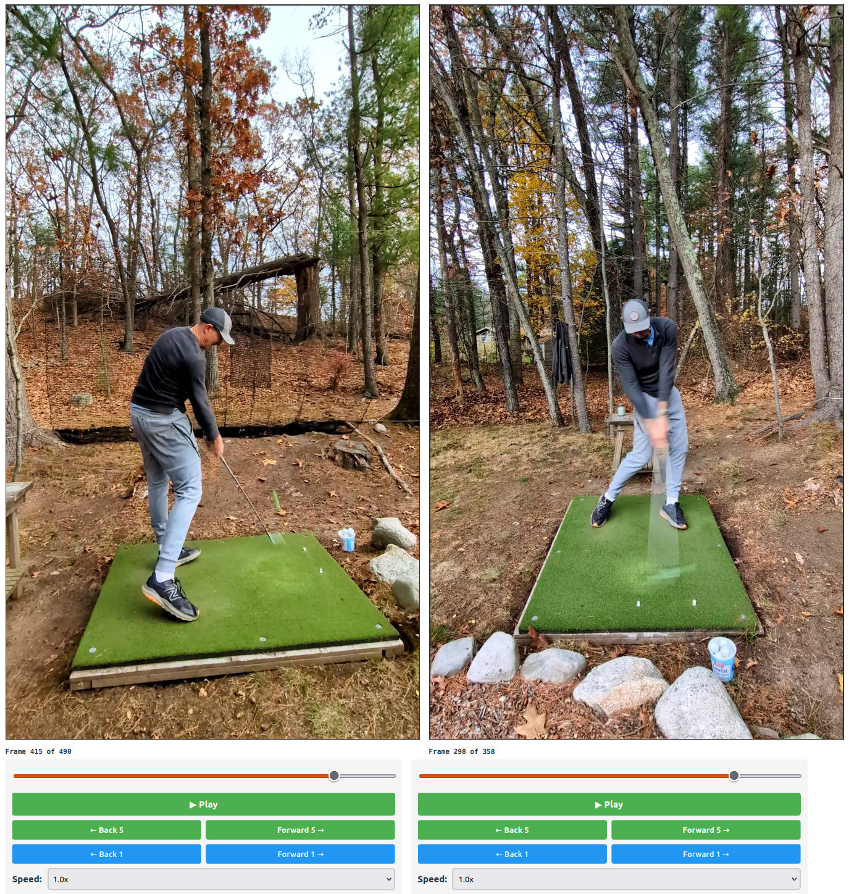
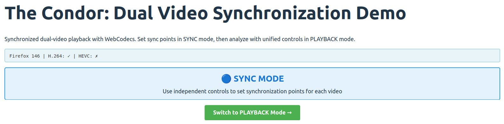
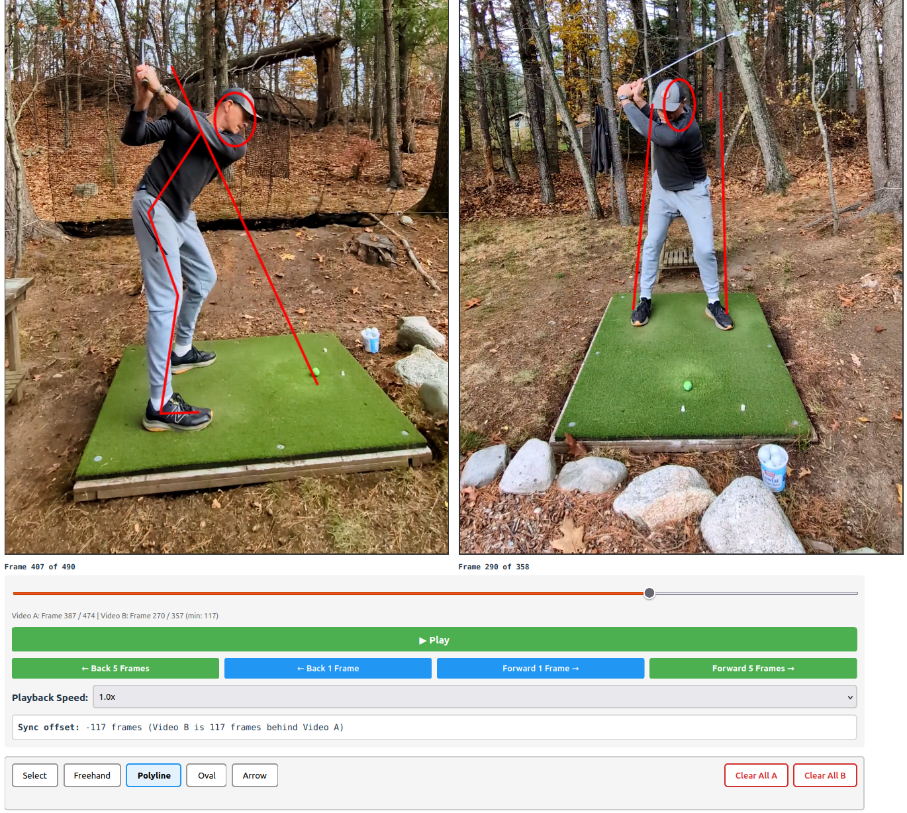

# The Condor: Golf Swing Analyzer

The Condor is an open-source platform for frame-accurate video analysis with dual-video synchronization and annotation tools.

## Quick Start

### Prerequisites

- **Node.js**: 18+ (for frontend development)
- **Python 3.11+**: For backend API
- **uv**: Python package manager ([install](https://docs.astral.sh/uv/getting-started/installation/))
- **npm** or **yarn**: Package management
- **Playwright Browsers**: For cross-browser testing

### Build Dev Container

1. **Configure**: Open `.devcontainer/connect-container.sh` and set `HOST_CODE_DIR` to your absolute project path (e.g., `/Users/<user>/Code/Claude/condor`).
2. **Build**: Create the image:
   ```bash
   ./.devcontainer/build-image.sh
   ```
3. **Connect**: Access the container environment:
   ```bash
   ./.devcontainer/connect-container.sh
   ```

For detailed instructions on managing the container image, cleaning up disk space, and troubleshooting, see `.devcontainer/DOCKER_MANAGEMENT.md`.

### Run Full Application (Frontend + Backend) from Dev Container

```bash

# Terminal 1: Backend services
# Install Python dependencies with uv (one time only)
uv sync

# Start backend services
uv run python -m backend.main
# Server starts at http://localhost:8000

# Terminal 2: Frontend
cd frontend

# Install frontend dependencies (one time only)
npm install

# Start frontend
npm run dev
# Use `npm run dev -- --host` when port forwarding outside of dev container
```

Open browser to http://localhost:5173 - you'll see the upload workflow for dual-video analysis.

### Run Legacy Demo (Frontend Only, No Backend)

To use the original Phase 0 demo with local file selection (no upload required):

```bash
# Edit frontend/src/App.tsx - change line 1:
# FROM: import { DualVideoSynchronizer } from "./components/DualVideoSynchronizer";
# TO:   import { DualVideoSyncDemo } from "./components/DualVideoSyncDemo";

# And change line 22:
# FROM: <DualVideoSynchronizer />
# TO:   <DualVideoSyncDemo />

cd frontend
npm run dev
# Open demo at http://localhost:5173
# Use `npm run dev -- --host` when port forwarding outside of dev container
```

### Instructions for Use

**Upload Workflow** (full application only): Select and upload two videos with optional rotation. After upload, the app enters synchronized playback mode.

**Playback** (both modes): The application starts in SYNC mode where you can independently control each video. Use the playback controls (play/pause, scrub bar, frame stepping) to synchronize the two videos, e.g. by setting them both to the impact frame:



Switch from sync mode to playback mode:



**Annotations** (both modes): Use the annotation tools to draw shapes representing key positions, angles, and checkpoints in the swing. For the polyline tool, each click-and-release creates a vertex; a double click places the final vertex and ends the line. All other tool drawing takes place with a single click and drag.



Annotations can be selected (ctrl-click to select multiple). White control points appear when selected. Click on the annotation body (not on a control point) and drag to move selected annotations. Click and drag on a control point to edit (resize/adjust) the annotation itself. Press delete to remove all selected annotations.

## Developer Setup

### Frontend Development

```bash
cd frontend
npm install
npm run dev
# Opens at http://localhost:5173
# Use `npm run dev -- --host` when port forwarding outside of dev container

# Build for production
npm run build
```

See `frontend/README.md` for details on running unit and integration tests.

### Backend Development

```bash
# Install Python dependencies
uv sync

# Run backend server
uv run python -m backend.main
# Server starts at http://localhost:8000
# API docs at http://localhost:8000/docs

# Run backend tests
uv run pytest backend/
```

## Docker Deployment

Condor ships production Docker images for `linux/amd64` and `linux/arm64`.

### Prerequisites

- Docker 24+ and Docker Compose v2
- 4+ GB RAM recommended
- Sufficient storage for the PostgreSQL data volume and video files

### Deploy

```bash
# 1. Clone the repository
git clone <repo-url> condor && cd condor

# 2. Configure environment (edit passwords for production)
cp .env.example .env

# 3. Build images and start all services (postgres, backend, frontend)
docker compose up --build -d

# 4. Open the application
#    http://<raspberry-pi-ip>:3000
```

The stack starts three containers:

| Container  | Port  | Description                                      |
| ---------- | ----- | ------------------------------------------------ |
| `postgres` | —     | PostgreSQL 15 (internal to Docker network only)  |
| `backend`  | 8000  | FastAPI API + video processing                   |
| `frontend` | 3000  | nginx serving SPA + reverse-proxying `/api/`     |

### Manage and Operate

```bash
# View running containers
docker compose ps

# Tail logs for all services
docker compose logs -f

# Tail backend logs only
docker compose logs -f backend

# Stop all services (data volumes are preserved)
docker compose down

# Stop and remove all data (⚠ irreversible)
docker compose down -v

# Rebuild after a code change
docker compose up --build -d
```

### Persistent Data

Two named Docker volumes store state outside the containers:

| Volume          | Content                              |
| --------------- | ------------------------------------ |
| `postgres_data` | PostgreSQL database files            |
| `video_storage` | Uploaded and processed video files   |

Both volumes survive `docker compose down` and are only removed with the `-v` flag.

### Configuration

Override any of the following in your `.env` file:

| Variable          | Default         | Description                   |
| ----------------- | --------------- | ----------------------------- |
| `POSTGRES_USER`   | `condor_user`   | Database username             |
| `POSTGRES_PASSWORD`| `condor_dev`   | Database password (**change for production**) |
| `POSTGRES_DB`     | `condor_db`     | Database name                 |
| `LOG_LEVEL`       | `INFO`          | Backend log verbosity         |
| `FRONTEND_PORT`   | `3000`          | Host port for UI              |
| `BACKEND_PORT`    | `8000`          | Host port for API (optional)  |

### Troubleshooting

| Symptom | Check |
| ------- | ----- |
| Frontend loads but API calls fail | Verify backend is healthy: `docker compose ps` and `curl http://localhost:8000/health` |
| `alembic upgrade head` fails on start | Database may still be initialising — restarting the backend container usually resolves this |
| Out of disk space | Remove unused Docker images with `docker image prune -a` |

### Testing

See component-specific README files:

- **Frontend**: `frontend/README.md` - Unit tests and Playwright E2E tests
- **Backend**: `backend/README.md` - Unit tests and integration tests

### Generate Test Videos

```bash
# Navigate to test fixtures
cd tests/fixtures

# Generate test videos with frame counters
bash generate_test_videos.sh

# Output: tests/fixtures/videos/
#   - test_30fps_10s.mp4       (H.264, 30fps, 10 seconds)
#   - test_60fps_5s.mp4        (H.264, 60fps, 5 seconds)
#   - test_30fps_10s_hevc.mp4  (H.265/HEVC, 30fps, 10 seconds)
```

## Repository Structure

```
condor/
├── backend/              # Backend source & unit tests
├── docs/                 # Technical documentation
│   └── spike/            # Detailed spike documentation
├── frontend/             # Frontend source & unit tests
│   ├── src/
│   │   ├── hooks/        # Custom React hooks (useFrameCallback)
│   │   └── components/   # UI components (FrameStepper)
│   └── tests/            # Playwright E2E tests
├── image/                # Images for documentation
├── inputs/               # Design input documentation
├── project/              # Project documentation (requirements and planning)
├── PRPs/                 # Product Requirements Prompts
├── tests/                # Integration tests
│   └── fixtures/         # Test video generation scripts
└── validation/           # Validation and review artifacts
```

## Technology Stack

### Backend

- **Python 3.11+**: FastAPI, uvicorn
- **uv**: Dependency management (`pyproject.toml`)
- **PostgreSQL / SQLAlchemy (asyncpg)**: Database
- **FFmpeg**: Video metadata extraction
- **Testing**: pytest

### Frontend

- **React 18**: UI framework
- **TypeScript**: Type safety
- **Vite**: Build tool
- **Zustand**: State management (Phase 1)
- **react-konva**: Canvas annotations (Phase 1)

### Testing

- **Playwright**: E2E cross-browser testing
- **Vitest**: Frontend unit tests (Phase 1)
- **pytest**: Backend unit tests (Phase 1)

## License

[License information to be added]

## Contact

[Contact information to be added]
