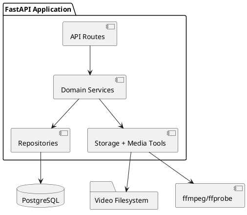
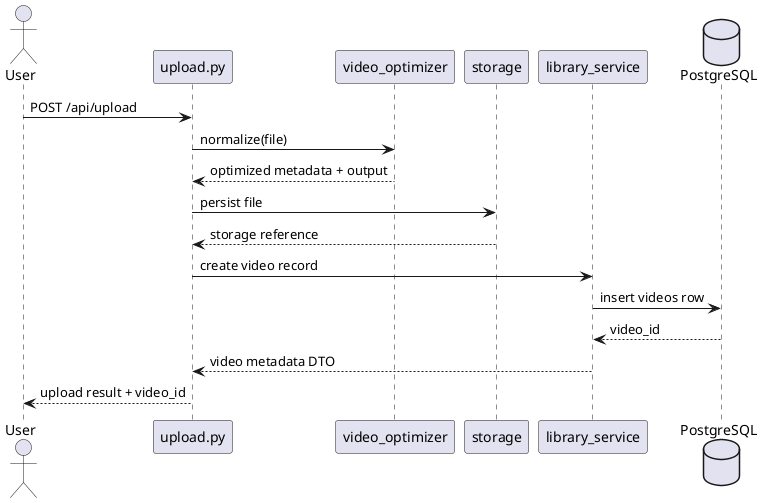
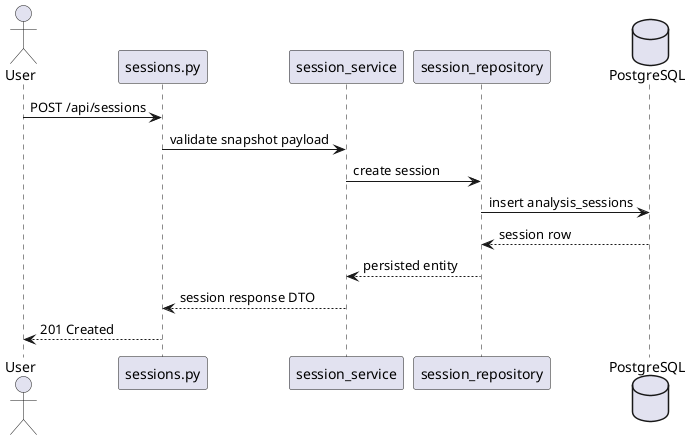
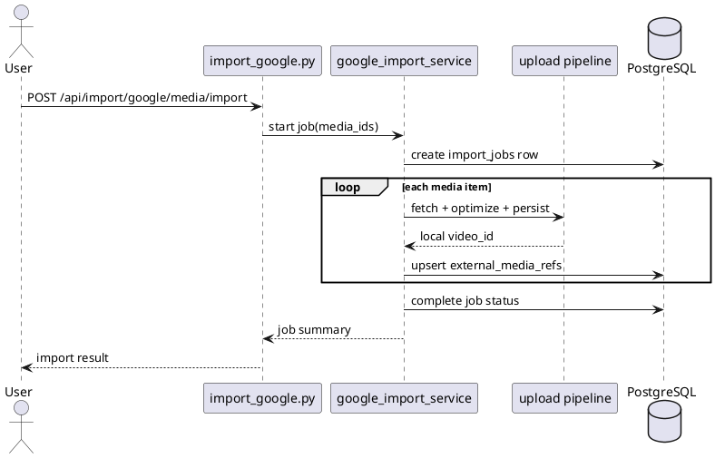

# Backend Design Description

## Document Control

- **Version**: 1.2
- **Last Updated**: 2026-02-27

## Overview

The backend is a FastAPI service that provides video ingest/optimization, library metadata management, session persistence, annotation persistence, and Google Photos import workflows.

The backend owns API contracts, media pipeline orchestration, persistence boundaries, and storage interfaces required by the Analyze, Library, Sessions, and Import frontend workflows.

## Runtime and Process Boundaries

## Module Architecture

The backend module set includes `backend/main.py`, route modules under `backend/routes/`, service modules under `backend/services/`, repository modules under `backend/repositories/`, schema contracts under `backend/schemas/`, and persistence models in `backend/models.py`.

`backend/main.py` registers domain routers and initializes application configuration for database and storage integration.

`backend/routes/upload.py` and `backend/routes/video.py` provide ingest and media streaming endpoints.

`backend/routes/library.py`, `backend/routes/sessions.py`, and `backend/routes/import_google.py` provide workflow APIs for library, sessions, and import domains.

`backend/services/video_optimizer.py`, `backend/services/storage.py`, and `backend/services/progress_tracker.py` provide media normalization, file storage operations, and asynchronous progress tracking.

`backend/services/library_service.py`, `backend/services/session_service.py`, `backend/services/annotation_service.py`, and `backend/services/google_import_service.py` provide domain orchestration and validation.

`backend/repositories/video_repository.py`, `backend/repositories/session_repository.py`, `backend/repositories/annotation_repository.py`, and `backend/repositories/import_repository.py` encapsulate persistence queries and mutations.

## API Surface

Library APIs: `GET /api/library/videos`, `GET /api/library/videos/{video_id}`, `PATCH /api/library/videos/{video_id}`, and `DELETE /api/library/videos/{video_id}`.

Session APIs: `POST /api/sessions`, `GET /api/sessions`, `GET /api/sessions/{session_id}`, `PUT /api/sessions/{session_id}`, and `DELETE /api/sessions/{session_id}`.

Annotation APIs: `GET /api/sessions/{session_id}/annotations` and `PUT /api/sessions/{session_id}/annotations`.

Google import APIs: `POST /api/import/google/auth/start`, `POST /api/import/google/auth/callback`, `GET /api/import/google/media`, `POST /api/import/google/media/import`, and `GET /api/import/google/jobs/{job_id}`.

## Platform and Data Setup

PostgreSQL is the required persistence platform for Phase 2 and is configured as the backend system of record.

Environment setup includes database server installation, provisioned database/user credentials, backend connection configuration, and migration execution before workflow APIs are used.

Database readiness validation includes successful application startup with DB connectivity and successful migration application.

## Data Model Design

Core tables are `users`, `videos`, `analysis_sessions`, and `annotations`.

`users` provides the default user identity used by current workflows.

`videos` stores ownership references, storage references, technical metadata, and editable user metadata.

`analysis_sessions` stores session metadata, linked video references, and persisted analysis payloads including sync/trim/playback state.

`annotations` stores session-scoped annotation payload data.

Import support tables are `import_jobs` and `external_media_refs` for provider job tracking and media mapping.

## Single-User Access Model

The current backend access model uses a single default user context and applies explicit ownership fields across persisted entities.

Service and repository interfaces remain user-scoped so the architecture can support multi-user authorization in future phases without interface redesign.

## Service Layer Behavior

Library service validates metadata updates, applies list/query semantics, and coordinates storage-consistent delete behavior.

Session service validates payload shape, persists session snapshots, and returns hydration-ready session responses.

Annotation service validates and normalizes annotation payloads and applies deterministic persistence ordering.

Google import service manages provider token flow, media selection/import orchestration, and import job lifecycle updates.

## Repository Layer Design

Repositories expose domain operations rather than route-shaped CRUD methods, including listing/filtering video records, resolving sessions with linked videos, replacing session annotations, and updating import job status.

This boundary keeps route handlers thin and centralizes persistence behavior for testability.

## Sequence Flows

### Upload to Library Flow

### Save Session Flow

### Google Import Flow

## Validation and Error Handling

Route boundaries enforce request contract validation with Pydantic, services enforce domain validation rules, and repository-level constraints are mapped to stable API error payloads.

The error model uses structured responses with `code`, `message`, and `details` and deterministic status codes including `400`, `404`, `409`, `422`, and `500`.

Asynchronous failures in upload and import workflows are surfaced through status endpoints.

## Testing Strategy

Backend tests include route tests for request/response behavior, service tests for domain orchestration, repository tests for persistence correctness, and integration tests for ingest, library, session, annotation, and import workflows.

Requirement-validating tests include requirement identifiers in docstrings to support traceability with validation reporting.
