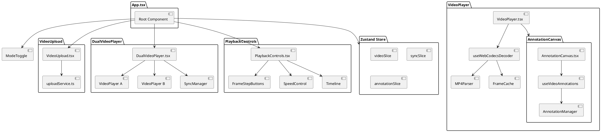
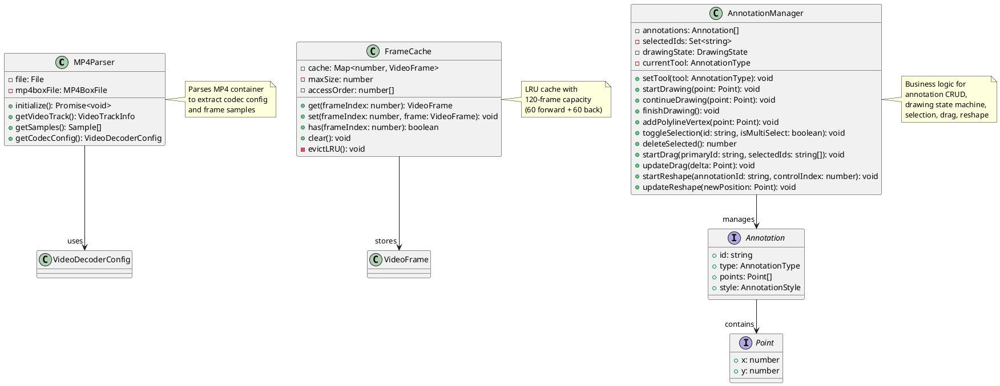
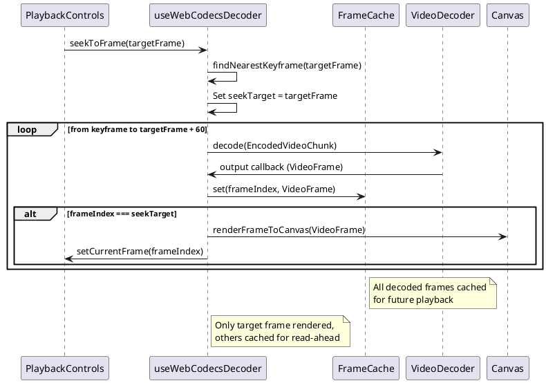
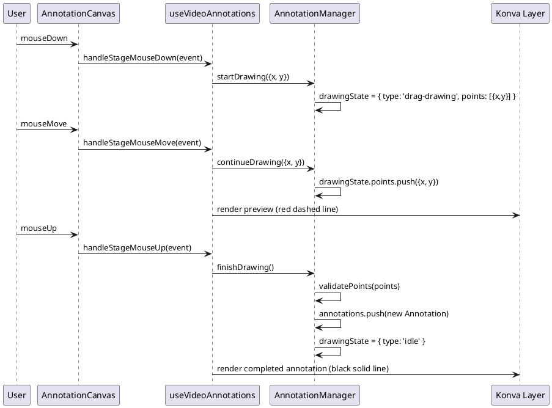
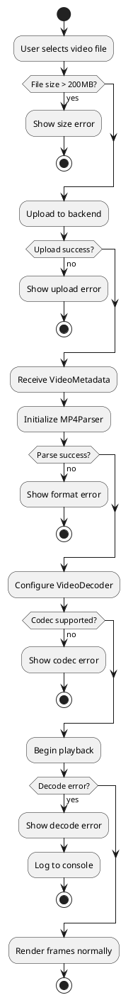

# Frontend - System Design Description

## Document Control

- **Version**: 1.0
- **Last Updated**: 2025-12-22

## Overview

The frontend is a React-based web application providing frame-accurate dual-video playback with temporal synchronization and canvas-based annotation capabilities. It leverages the WebCodecs API for deterministic frame-by-frame video decode and rendering, enabling exact frame positioning (0 tolerance) required for golf swing analysis. The application supports two operational modes: Sync Mode for independent video control and sync point selection, and Playback Mode for synchronized playback with unified controls.

The frontend architecture prioritizes performance through efficient state management (Zustand), bounded memory usage (LRU frame caching), and optimized canvas rendering (react-konva).

## Responsibilities

### Primary Responsibilities

- **Frame-Accurate Video Playback**: Decode and render video frames with exact frame positioning using WebCodecs API, maintaining 0 frame error for dual-video synchronization
- **Dual-Video Synchronization**: Calculate and maintain temporal offset between two videos based on user-selected sync point, ensuring synchronized playback during all operations (stepping, seeking, speed changes)
- **Canvas-Based Annotations**: Provide drawing tools (freehand, polyline, oval, arrow) with canvas overlay, supporting selection, dragging, and reshaping of annotations
- **Playback Controls**: Unified interface for play/pause, variable speed (0.1x-2.0x), frame stepping (coarse/fine), scrubbing, and looping
- **Video Upload**: File selection, validation (format, size), upload to backend, and metadata retrieval

### Secondary Responsibilities

- **Mode Switching**: Toggle between Sync Mode (independent controls) and Playback Mode (unified controls)
- **Trim Functionality**: Non-destructive trim points for constraining playback range
- **Error Handling**: User-facing error messages for upload failures, browser incompatibility, video format issues
- **State Persistence**: Maintain annotation state, sync offset, and playback position during session

## Theory of Operation

### Frame-Accurate Video Control with WebCodecs

The frontend achieves deterministic frame positioning by bypassing HTML5 video seeking (which is non-deterministic, ±1 frame variance) and implementing direct frame decode using the WebCodecs API:

1. **MP4 Container Parsing**: Parse uploaded MP4 file using mp4box.js to extract codec configuration and frame samples (EncodedVideoChunks)
2. **VideoDecoder Initialization**: Configure VideoDecoder with codec parameters (H.264/H.265), register output callback for decoded frames
3. **Frame Seeking**: To seek to frame N:
   - Find nearest keyframe at or before frame N (GOP=30 from server optimization)
   - Decode frames from keyframe → N + 60 (60-frame read-ahead for playback buffer)
   - Cache all decoded frames in LRU cache (max 120 frames)
   - Render target frame N to canvas
4. **Continuous Playback**: requestAnimationFrame loop renders cached frames at calculated intervals based on framerate and playback speed
5. **Cache Strategy**: 60-frame read-ahead + 60-frame backward buffer = 120-frame LRU cache (~120MB @ 1080p)

**See**: `docs/spike/WEBCODECS_FRAME_CONTROL.md` for detailed implementation including critical learnings about `flush()`, MP4 decode order vs presentation order, and React ref lifecycle timing.

### Dual-Video Synchronization

Synchronization is achieved through offset-based frame positioning:

1. **Sync Mode**: User navigates each video independently to desired sync point (e.g., ball impact frame)
2. **Offset Calculation**: When switching to Playback Mode, calculate `offset = syncFrameB - syncFrameA`
3. **Synchronized Operations**: For all playback operations (step, seek, play), maintain offset:
   - Step forward: `frameA += 1, frameB = frameA + offset`
   - Seek to frame N: `frameA = N, frameB = N + offset`
   - Playback: Both videos render exact frame numbers with offset maintained

### Annotation System

Canvas-based annotation system using react-konva for overlay rendering:

1. **Architecture**: `AnnotationManager` (business logic) + `useVideoAnnotations` hook (React integration) + Canvas components (rendering)
2. **Coordinate System**: Konva Stage dimensions match video intrinsic dimensions (e.g., 1920×1080), CSS scaling applied to match displayed size
3. **Drawing Patterns**:
   - **Drag-based** (freehand, oval, arrow): mouseDown → mouseMove (append/update points) → mouseUp (finalize)
   - **Click-based** (polyline): click (add vertex) → click (add vertex) → Enter/double-click (finalize)
4. **State Machine**: idle → drawing (tool-specific) → idle, with preview rendering during drawing phase
5. **Interactive Features**: Selection (click annotation), multi-select (ctrl+click), drag (move annotations), reshape (drag control points)

**See**: `docs/spike/ANNOTATIONS.md` for detailed architecture including `AnnotationManager` design, custom hook pattern, and control point reshape implementation.

### State Management

Zustand slices provide modular, performant state management:

- **videoSlice**: Video metadata (framerate, duration, dimensions), current frame numbers, refs (not stored in Zustand)
- **syncSlice**: Sync offset, operational mode (sync/playback), sync frame numbers
- **annotationSlice**: Annotation data arrays per video, selected IDs, active tool

## Implementation Architecture

### Component Hierarchy



### Core Classes and Utilities



### Key Interaction Flows

#### Frame Seeking Sequence



#### Annotation Drawing Sequence (Freehand)



## Interfaces

### Input Interfaces

| Interface         | Data Format           | Protocol/Method | Description                                                      |
| ----------------- | --------------------- | --------------- | ---------------------------------------------------------------- |
| User Interactions | Mouse/Keyboard Events | DOM Events      | Canvas clicks, drags, keyboard shortcuts (Enter, Escape, Delete) |
| Video Files       | MP4 (H.264/H.265)     | File API        | User-selected video files via upload interface                   |
| Backend API       | JSON                  | HTTP/REST       | Video metadata, upload response, streaming URLs                  |

### Output Interfaces

| Interface        | Data Format   | Protocol/Method   | Description                                                              |
| ---------------- | ------------- | ----------------- | ------------------------------------------------------------------------ |
| Canvas Rendering | ImageBitmap   | Canvas 2D Context | Video frames + annotation overlay rendered to canvas elements            |
| API Requests     | JSON / Binary | HTTP/REST         | Upload requests, metadata fetch, video streaming with Range headers      |
| User Feedback    | UI Components | React State       | Error notifications, loading indicators, frame counters, mode indicators |

### Key Data Structures

**VideoMetadata** (from backend):

```typescript
interface VideoMetadata {
  video_id: string;
  session_id: string;
  framerate: number;
  duration: number;
  width: number;
  height: number;
  codec: string;
  gop_size: number;
}
```

**Annotation**:

```typescript
interface Annotation {
  id: string;
  type: "freehand" | "polyline" | "oval" | "arrow";
  points: Point[];
  style: {
    color: string;
    strokeWidth: number;
  };
}

interface Point {
  x: number;
  y: number;
}
```

**SyncState**:

```typescript
interface SyncState {
  mode: "sync" | "playback";
  syncFrameA: number;
  syncFrameB: number;
  offset: number; // frameB - frameA
}
```

## Error Handling Strategy

### Error Types

| Error Type             | Cause                                     | Handling Strategy                 | User Feedback                                                                                         |
| ---------------------- | ----------------------------------------- | --------------------------------- | ----------------------------------------------------------------------------------------------------- |
| BrowserIncompatibility | WebCodecs API unavailable                 | Detect on mount, block app usage  | "Your browser doesn't support required features. Update to Chrome 94+, Firefox 130+, or Safari 17.4+" |
| VideoFormatError       | Unsupported codec (HEVC in some contexts) | Detect during MP4 parsing         | "This video format is not compatible. Please use MP4 with H.264 codec"                                |
| UploadError            | Network failure, server rejection         | Axios error handling              | "Upload failed: [error message]" (toast notification)                                                 |
| FileSizeError          | Video exceeds 200MB                       | Frontend validation before upload | "Video file exceeds maximum size (200MB)"                                                             |
| DecodeError            | VideoDecoder failure                      | Catch in output callback          | "Video decode failed. File may be corrupted"                                                          |

### Error Handling Flow



### Logging and Monitoring

- **Error Logging**: Browser `console.error()` with stack traces for decode failures, API errors
- **Performance Monitoring**:
  - Cache hit rate tracking (target >80%)
  - Frame decode latency measurement (target <50ms)
  - Render latency for annotations (target ≤16ms)
- **Health Checks**: WebCodecs API availability check on app initialization

## Dependencies

### External Dependencies

| Dependency    | Version        | Purpose                      | Failure Impact                         |
| ------------- | -------------- | ---------------------------- | -------------------------------------- |
| WebCodecs API | Browser Native | Frame-by-frame video decode  | App unusable without WebCodecs support |
| mp4box.js     | latest         | MP4 container parsing        | Cannot load videos (critical)          |
| react-konva   | 18             | Canvas annotation rendering  | Annotation features disabled           |
| axios         | 1              | HTTP client for API requests | Cannot upload/stream videos (critical) |

### Internal Dependencies

| Module        | Interface Used | Purpose                                         | Coupling Level        |
| ------------- | -------------- | ----------------------------------------------- | --------------------- |
| Backend API   | REST endpoints | Video upload, streaming, metadata               | Loose (HTTP)          |
| Zustand Store | State slices   | Global state access                             | Loose (hooks)         |
| Custom Hooks  | Hook APIs      | Encapsulated logic (decoder, annotations, sync) | Loose (React context) |

### Configuration Dependencies

| Configuration      | Type   | Purpose                     | Default Value         |
| ------------------ | ------ | --------------------------- | --------------------- |
| API_BASE_URL       | string | Backend API endpoint        | http://localhost:8000 |
| FRAME_CACHE_SIZE   | number | Maximum cached frames       | 120                   |
| UPLOAD_MAX_SIZE_MB | number | Client-side file size limit | 200                   |

## Testing Strategy

### Unit Testing

- **Test Coverage**: >80% for utilities, hooks, business logic
- **Test Framework**: Vitest with React Testing Library
- **Mock Strategy**:
  - WebCodecs API: Mock VideoDecoder, EncodedVideoChunk
  - API requests: Mock axios responses
  - File uploads: Mock File objects

**Key Test Suites**:

- `FrameCache.test.ts`: LRU eviction, capacity limits
- `AnnotationManager.test.ts`: CRUD operations, drawing state machine, selection, drag, reshape (137 tests)
- `useVideoAnnotations.test.ts`: Hook integration, keyboard shortcuts, event handlers (38 tests)
- `MP4Parser.test.ts`: Container parsing, codec extraction

### Integration Testing

- **Integration Points**: Full user workflows (upload → sync → annotate → playback)
- **Test Framework**: Playwright (cross-browser)
- **Test Data**: Generated test videos with known frame counts, GOP=30
- **Environment**: Headless Chrome, Firefox, WebKit

**Key Test Scenarios**:

- Frame stepping accuracy (0 tolerance validation)
- Dual-video synchronization maintenance
- Annotation drawing, selection, deletion
- Canvas overlay alignment during window resize
- Playback at variable speeds (0.1x-2.0x)

### Performance Testing

- **Cache Performance**: Measure cache hit rate during typical playback (target >80%)
- **Decode Latency**: Measure time from decode() call to frame render (target <50ms)
- **Annotation Latency**: Measure drawing tool responsiveness (target ≤16ms for 60fps feel)

**Benchmarks**:
| Metric | Target | Test Method |
|--------|--------|-------------|
| Cache hit rate | >80% | Playwright performance profiling |
| Cache miss latency | <300ms | Measure decode time from keyframe (GOP=30) |
| Annotation draw latency | ≤16ms | RAF timestamp deltas during drawing |

## Deployment Considerations

### Resource Requirements

Browser environment:

- **Memory**:
  - Frame cache: ~120MB (120 frames × 1MB/frame @ 1080p) × 2 videos = 240MB
  - React app: ~50MB
  - Total: ~300MB browser memory
- **CPU**: WebCodecs decode (hardware-accelerated when available), canvas rendering
- **GPU**: Canvas compositing, potential hardware video decode

### Browser Configuration

- WebCodecs API must be enabled (default in Chrome 94+, Firefox 130+, Safari 17.4+)
- Hardware acceleration recommended (Settings → System → Use hardware acceleration)
- Sufficient memory allocation for video decode

### Scaling Considerations

- **Memory bounded**: Frame cache size fixed (120 frames), no unbounded growth
- **Cleanup**: Zustand state cleared on session end, VideoFrames explicitly closed to prevent memory leaks

## Future Enhancements

- **Annotation Persistence**: Save/load annotation sets with JSON serialization
- **Advanced Annotation Tools**: Custom colors, line thickness, text annotations
- **Frame-Specific Annotations**: Time-based annotations that appear/disappear at specific frames
- **Comparison Mode**: Overlay mode (blend two videos), 3+ video support
- **Export Functionality**: Export annotated frame as image, export video segment
- **Offline Support**: Service worker for offline playback of cached videos
- **Mobile Support**: Touch-based annotation drawing, responsive layout for tablets
- **Multi-User Support**: Session sharing, collaborative annotations
