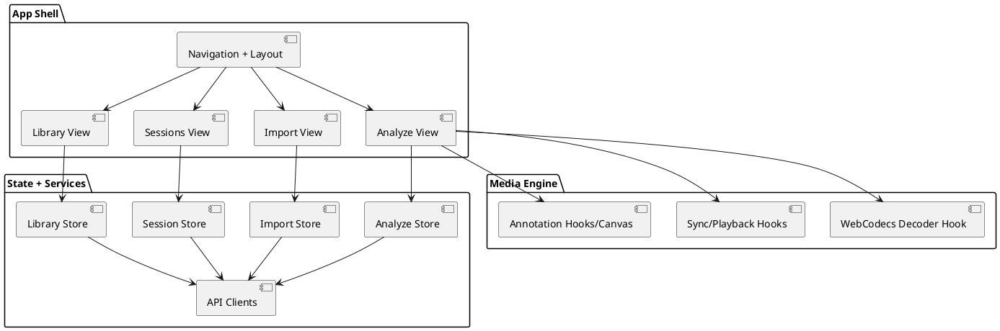
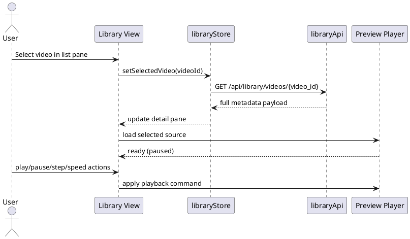
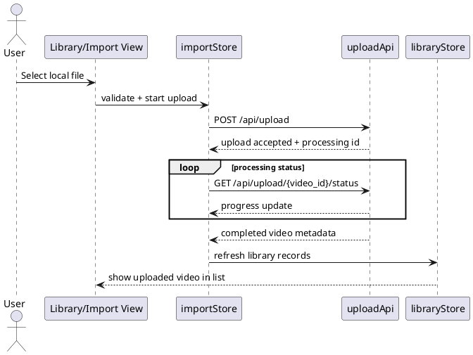
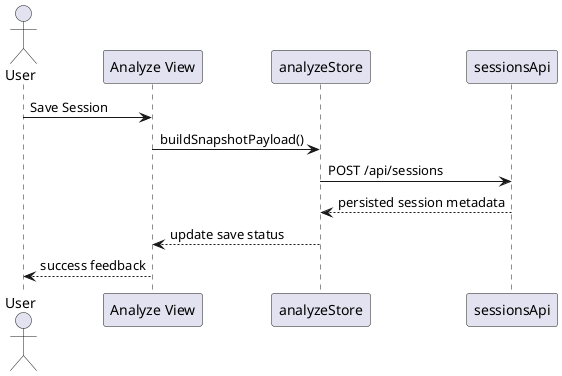

# Frontend Design Description

## Document Control

- **Version**: 1.2
- **Last Updated**: 2026-02-21

## Overview

The frontend is a React + TypeScript application with a unified app shell for Analyze, Library, Sessions, and Import workflows.

The frontend owns user interaction state, frame-accurate playback controls, session hydration behavior, metadata editing flows, and import orchestration feedback.

## Application Composition

## Module Architecture

Application shell composition is defined in `src/App.tsx` and layout/navigation components under `src/components/layout/`.

Analyze workflow composition is implemented in `src/components/DualVideoSynchronizer.tsx` and analysis hooks including `src/hooks/useWebCodecsDecoder.ts`, `src/hooks/useVideoSynchronization.ts`, and `src/hooks/useVideoAnnotations.ts`.

Library workflow components are under `src/components/library/` with state/actions in `src/store/libraryStore.ts` and API integration in `src/services/libraryApi.ts`.

Upload workflow components are under `src/components/upload/` and `src/components/import/` with upload/import state handling in `src/store/importStore.ts` and transport/orchestration APIs in `src/services/importApi.ts` and upload-related client modules.

Sessions workflow components are under `src/components/sessions/` with state/actions in `src/store/sessionStore.ts` and API integration in `src/services/sessionsApi.ts` and `src/services/annotationsApi.ts`.

Import workflow components are under `src/components/import/` with state/actions in `src/store/importStore.ts` and API integration in `src/services/importApi.ts`.

Analyze workspace state is managed in `src/store/analyzeStore.ts` and includes selected videos, sync state, trim/playback state, and annotation payloads.

## Routing and Navigation Design

Navigation exposes four workflow entry points: Analyze, Library, Sessions, and Import.

Navigation state is isolated from workflow data state so view transitions do not clear analysis or persistence context unless explicitly requested by the user.

Analyze is the default working surface and accepts selected media from Library and hydrated state from Sessions.

## State and Data Contracts

Persisted analysis session payload includes `primaryVideoId`, optional `secondaryVideoId`, synchronization state, trim/playback state, and annotation payload arrays.

Library metadata contract includes technical media metadata and user-editable metadata fields for golfer name, capture date, club, notes, and quality score.

Session list contract includes session identity, title/notes, linked video references, and timestamps used for listing and selection.

## Workflow Interaction Design

### Library to Analyze Flow

1. User opens Library and selects one or two videos.
2. Library workflow updates Analyze selection state.
3. Analyze view initializes playback and annotation workspace for selected assets.

### Library Preview Playback Flow

1. User opens Library and selects a video from list view.
2. Library detail pane loads full metadata and initializes preview player in paused state.
3. User controls preview using play/pause, fine/coarse step, and playback speed controls.
4. User confirms selection for Analyze after previewing.

### Sequence Diagram: Library Preview Playback

### Local Upload to Library Flow

1. User starts local upload from Library or Import entry point.
2. Frontend validates selected file and submits upload request.
3. Frontend displays upload and processing status.
4. On completion, frontend refreshes Library and exposes uploaded media for preview and analysis selection.

### Sequence Diagram: Local Upload to Library

### Analyze Save and Load Flow

1. User performs playback, synchronization, trim, and annotation actions in Analyze.
2. Save action serializes canonical analysis payload and session metadata.
3. Sessions workflow lists saved sessions and loads selected session payloads.
4. Analyze workflow hydrates state and resumes analysis from loaded payload.

### Import to Library Flow

1. User opens Import and authorizes provider access.
2. User selects provider media and starts import.
3. Import workflow displays job progress and completion state.
4. Library workflow refreshes and displays imported video records.

### Sequence Diagram: Save Session

## UI Behavior and Constraints

Analyze interaction responsiveness is treated as a primary UX constraint.

Library, Sessions, and Import asynchronous operations expose deterministic loading, success, and error feedback.

Session loading is a client-side hydration operation that does not persist backend changes until explicit save.

Trim controls support bounded playback behavior and trim reset behavior.

Keyboard shortcuts support core playback and stepping operations and do not override active text input contexts.

## Error Handling Strategy

Workflow errors are surfaced through domain-specific notifications tied to store actions.

Retry actions are available for transient network/import failures.

Error handling in auxiliary workflows does not block Analyze interactions when dependencies are not shared.

## Performance Design

WebCodecs decode/render path is isolated from non-analysis workflow state updates.

Library and session list workflows use paginated fetch patterns and memoized selectors.

Import progress polling uses bounded intervals and pauses when workflow visibility is inactive.

Session hydration applies payload state deterministically to avoid long main-thread stalls.

## Testing Strategy

Frontend tests include component tests for workflow views, store tests for state transitions and asynchronous actions, API client tests for contract mapping, and Playwright workflow tests for import, library selection, and session save/load behavior.

Requirement-validating tests include requirement identifiers in test metadata where needed for validation traceability.
