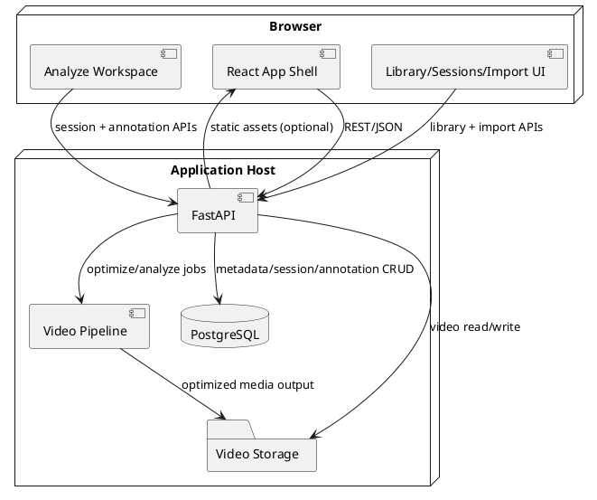
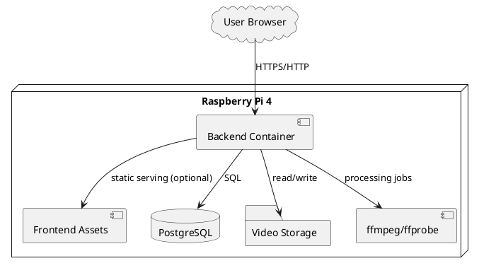

# System Architecture Description

## Document Control

- **Version**: 1.1
- **Last Updated**: 2026-02-27

## Overview

Condor is a web application for golf swing analysis with integrated workflows for library management, analysis execution, session persistence, and cloud media import.

The architecture combines a React frontend for frame-accurate playback and annotations with a FastAPI backend for ingest, optimization, streaming, persistence APIs, and import orchestration.

## Runtime Topology

The runtime has three planes: browser application runtime (React + WebCodecs + Canvas), API/media runtime (FastAPI + ffmpeg/ffprobe), and persistence/storage runtime (PostgreSQL + filesystem video storage).

## Component Architecture

Component ownership is organized by workflow domains.

| Domain | Frontend Modules | Backend Modules | Data Owned |
| --- | --- | --- | --- |
| Analyze | `components/DualVideoSynchronizer.tsx`, `hooks/useWebCodecsDecoder.ts`, `hooks/useVideoAnnotations.ts` | `routes/video.py`, session/annotation routes | playhead, sync, trim/playback, and annotation working state |
| Library | `components/library/*`, `services/libraryApi.ts` | `routes/library.py`, `services/library_service.py` | video metadata catalog |
| Sessions | `components/sessions/*`, `services/sessionsApi.ts` | `routes/sessions.py`, `services/session_service.py` | saved analysis snapshots |
| Import | `components/import/*`, `services/importApi.ts` | `routes/import_google.py`, `services/google_import_service.py` | import jobs and external media references |
| Upload/Optimize | upload workflow components | `routes/upload.py`, `services/video_optimizer.py`, `services/storage.py` | source and optimized video assets |

## Workflow Architecture

### Library Ingest Workflow

1. User ingests media from local upload or Google import.
2. Backend normalizes media using codec, GOP, and rotation policy.
3. Backend stores media in filesystem and persists metadata in PostgreSQL.
4. Frontend refreshes library state and exposes media for Analyze.

### Analyze and Save Workflow

1. User selects one or two videos from Library.
2. Analyze workspace executes decode, synchronization, trim, playback, and annotation interactions.
3. User saves a session snapshot.
4. Backend persists session header and full analysis payload linked to video IDs.

### Load Session Workflow

1. User selects a session from Sessions.
2. Backend returns session payload and linked video references.
3. Frontend hydrates Analyze state for sync, trim/playback, and annotations.

### Google Import Workflow

1. User authorizes Google Photos in Import.
2. Backend enumerates provider media.
3. Selected media is processed through upload/optimize/storage path.
4. Imported assets appear in Library as standard video records.

## Data Architecture

PostgreSQL is the system of record for workflow metadata and analysis state, and filesystem storage is the source of video bytes for streaming and decode.

- `videos` stores media identity and metadata.
- `analysis_sessions` stores session headers and state payload references.
- `annotations` stores normalized annotation payloads linked to sessions.
- `import_jobs` and `external_media_refs` store import orchestration and media mapping data.

Metadata required for search/filter/list behavior is modeled as explicit fields, and dynamic analysis payload data is stored as structured JSON.

## Interface Boundaries

The API surface is segmented by domain: Upload/stream (`/api/upload`, `/api/video/...`), Library (`/api/library/videos...`), Sessions (`/api/sessions...`), Annotations (`/api/sessions/{id}/annotations...`), and Import (`/api/import/google/...`).

Frontend integrations use typed API clients per domain to reduce cross-workflow coupling.

## Technology Stack

| Layer | Technology | Purpose |
| --- | --- | --- |
| Frontend | React 18 + TypeScript + Vite | Shell routing and interactive workflows |
| Decode/Render | WebCodecs + Canvas + `react-konva` | Exact frame decode and annotation overlay |
| Backend | Python 3.11 + FastAPI + Uvicorn | Domain APIs and orchestration |
| Media Processing | `ffmpeg`, `ffprobe` | Codec/GOP normalization and metadata extraction |
| Persistence | PostgreSQL | System-of-record data |
| Storage | Filesystem | Media storage and range-stream source |
| Testing | Vitest, pytest, Playwright | Unit + integration + workflow validation |

## Testing and Validation Architecture

Testing is organized by domain and validation intent with unit tests for module logic, integration tests for API/DB/storage/pipeline interactions, and browser workflow tests for Analyze/Library/Sessions/Import journeys.

Each workflow has user-exercisable validation outputs that support acceptance verification.

## Deployment Architecture

The deployment target is Raspberry Pi 4 with containerized runtime including backend API, media processing dependencies, database connectivity, and frontend static assets.

