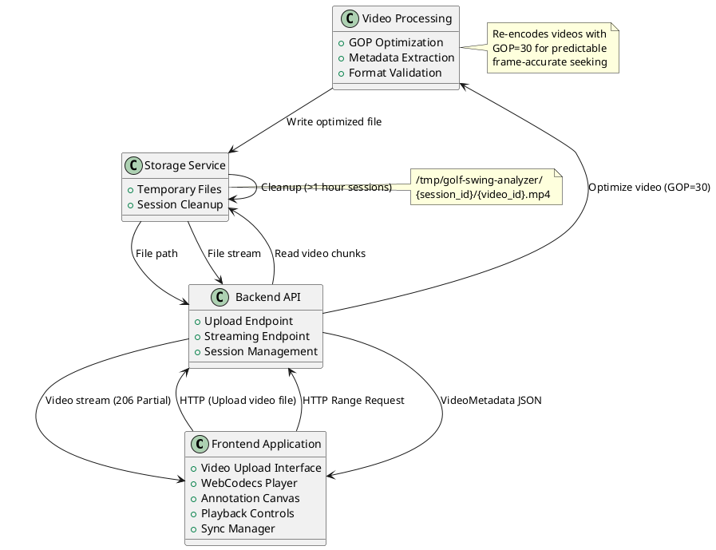
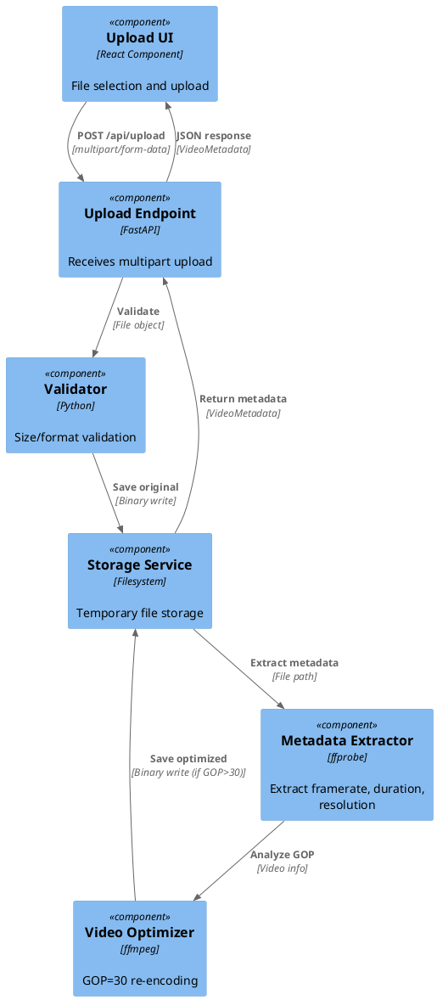
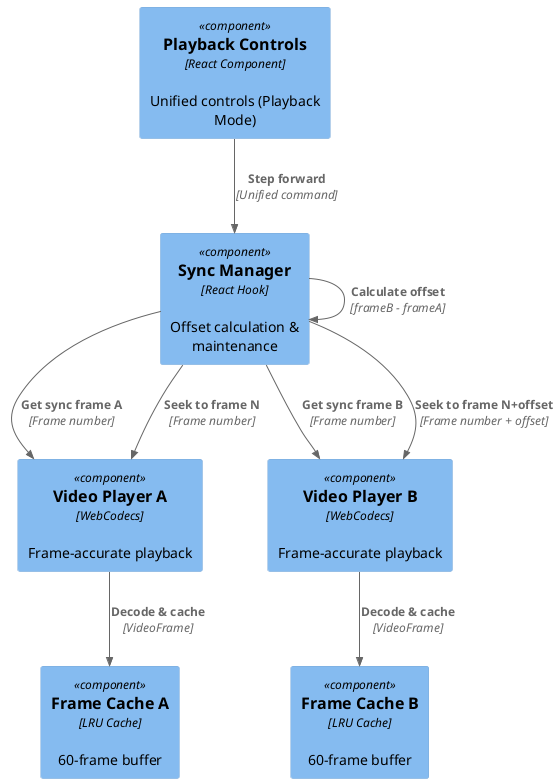
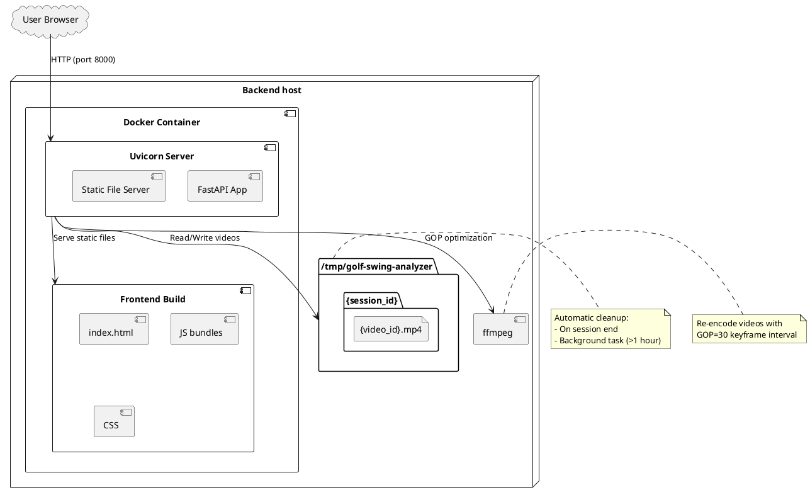

# System Architecture Description

## Document Control

- **Version**: 1.0
- **Last Updated**: 2025-12-22

## Overview

The Condor Golf Swing Analyzer is a web-based application enabling frame-accurate dual-video comparison with temporal synchronization and annotation capabilities. The system allows users to upload swing videos, synchronize them at specific points (e.g., ball impact), and analyze frame-by-frame using drawing annotations to highlight swing mechanics.

The architecture employs a client-server model with a React-based frontend providing the user interface and video playback, and a FastAPI backend handling video upload, optimization, and streaming. The system prioritizes frame-exact accuracy (0-frame tolerance) for dual-video synchronization, which is critical for golf swing analysis at slow-motion speeds (0.1x-0.5x) and in frame-by-frame stepping.

## System Components

### Major Components

| Component                     | Responsibility                                                    | Key Technologies                                      |
| ----------------------------- | ----------------------------------------------------------------- | ----------------------------------------------------- |
| **Frontend Application**      | User interface, video playback, annotations, synchronization      | React 18, TypeScript 5, WebCodecs API, react-konva 18 |
| **Backend API**               | Video upload, optimization, streaming, metadata extraction        | Python 3.11, FastAPI 0.109, ffmpeg                    |
| **Video Processing Pipeline** | GOP optimization (GOP=30), format conversion, metadata extraction | ffmpeg, ffprobe                                       |
| **Storage Service**           | Temporary file storage, session management, cleanup               | Filesystem (/tmp), background tasks                   |

### Component Interactions

## Information & Data Flow

### Key Workflows

#### Video Upload & Optimization Workflow

#### Dual-Video Playback & Synchronization Workflow

## Technology Stack

### Core Technologies

| Layer                | Technology          | Version | Purpose                     |
| -------------------- | ------------------- | ------- | --------------------------- |
| **Frontend**         | React               | 18      | UI framework                |
|                      | TypeScript          | 5       | Type-safe development       |
|                      | Vite                | 5       | Build tool and dev server   |
|                      | Zustand             | 4       | State management            |
|                      | react-konva / konva | 18 / 9  | Canvas-based annotations    |
|                      | Axios               | 1       | HTTP client                 |
|                      | mp4box.js           | latest  | MP4 container parsing       |
| **Backend**          | Python              | 3.11+   | Runtime                     |
|                      | FastAPI             | 0.109   | REST API framework          |
|                      | Uvicorn             | 0.27    | ASGI server                 |
|                      | Pydantic            | 2       | Data validation             |
|                      | aiofiles            | 23      | Async file I/O              |
| **Video Processing** | ffmpeg              | system  | Video transcoding           |
|                      | ffprobe             | system  | Metadata extraction         |
| **Browser APIs**     | WebCodecs           | -       | Frame-by-frame video decode |
|                      | Canvas              | -       | Video rendering             |

### Development Tools

| Tool                  | Purpose                            |
| --------------------- | ---------------------------------- |
| Playwright            | End-to-end testing (cross-browser) |
| Vitest                | Frontend unit testing              |
| pytest                | Backend unit testing               |
| React Testing Library | React component testing            |
| Docker                | Containerization                   |
| uv                    | Python dependency management       |

## Dependencies

### External Dependencies

| Dependency  | Version | Purpose                                 | License      |
| ----------- | ------- | --------------------------------------- | ------------ |
| mp4box.js   | latest  | MP4 container parsing for WebCodecs     | BSD-3-Clause |
| react-konva | 18      | React bindings for Konva canvas library | MIT          |
| konva       | 9       | Canvas-based drawing and annotations    | MIT          |
| ffmpeg      | system  | Video transcoding (GOP=30 optimization) | LGPL/GPL     |
| axios       | 1       | HTTP client for API requests            | MIT          |
| zustand     | 4       | Lightweight state management            | MIT          |
| FastAPI     | 0.109   | Modern Python web framework             | MIT          |
| aiofiles    | 23      | Async file I/O operations               | Apache-2.0   |

### Browser Requirements

- **Chrome**: 94+ (WebCodecs support)
- **Firefox**: 130+ (WebCodecs support)
- **Safari**: 17.4+ (WebCodecs support)
- **Market Coverage**: ~95% of active browsers

## Test Strategy

### Testing Approach

- **Unit Tests**: Comprehensive coverage of business logic, utilities, and state management

  - Frontend: Vitest for components, hooks, utilities
  - Backend: pytest for services, API endpoints, video processing
  - Target: >80% code coverage (REQ-NF-M-001)

- **Integration Tests**: End-to-end workflows validating cross-component interactions

  - Playwright for full user workflows (upload → sync → annotate → playback)
  - Cross-browser testing (Chrome, Firefox, WebKit)
  - Requirement-validating tests reference requirement IDs for traceability

- **Performance Tests**: Frame accuracy, cache performance, decode latency
  - Frame stepping accuracy: 0 tolerance (exact frame positioning)
  - Cache hit rate: >80% during typical playback
  - Cache miss latency: <300ms (with GOP=30 optimization)

### Test Infrastructure

| Component               | Tool/Framework           | Purpose                                      |
| ----------------------- | ------------------------ | -------------------------------------------- |
| Unit Testing (Frontend) | Vitest 1                 | Fast unit tests with React component support |
| Unit Testing (Backend)  | pytest                   | Python testing framework                     |
| Integration Testing     | Playwright 1.41          | Cross-browser E2E testing                    |
| Component Testing       | React Testing Library 14 | React component interaction testing          |
| CI/CD                   | GitHub Actions           | Automated test execution across browsers     |

### Coverage and Quality Gates

- **Minimum Coverage**: 80% code coverage
- **Quality Gates**:
  - All unit tests passing
  - All integration tests passing across Chrome, Firefox, WebKit
  - Zero linting errors (ESLint frontend, Ruff backend)
  - Zero type errors (TypeScript frontend, mypy backend)
- **Automated Testing**: CI runs full test suite on every commit

## Deployment Architecture

### Initial Deployment Platform

**Raspberry Pi 4 (8GB RAM)** - MVP deployment target

- ARM64 architecture
- Ubuntu 22.04 LTS
- Docker containerization for consistent deployment
- Backend serves both API and static frontend files

### Deployment Structure

### Resource Requirements

Initial deployment (Raspberry Pi 4):

- **Memory**: 8GB RAM (dual 1080p video decode + caching + re-encoding)
- **CPU**: ARM Cortex-A72 (quad-core) - software H.264 encoding at 0.42x realtime
- **Storage**: Temporary storage for uploaded videos (cleanup after 1 hour)
- **Network**: Local network deployment (LAN access)

### Configuration

Key environment variables (`.env`):

- `UPLOAD_MAX_SIZE_MB`: Maximum video upload size (default: 200)
- `TMP_STORAGE_PATH`: Temporary file storage location (default: /tmp/golf-swing-analyzer)
- `CLEANUP_INTERVAL_MINUTES`: Background cleanup frequency (default: 15)
- `SESSION_MAX_AGE_HOURS`: Session expiration time (default: 1)
- `LOG_LEVEL`: Logging verbosity (default: INFO)

## Security Considerations

- **File Upload Validation**: Size limits (200MB), format validation (MP4 only), MIME type checking
- **Session Isolation**: UUID-based session IDs prevent cross-session access
- **Temporary Storage**: Videos stored in isolated session directories, automatic cleanup
- **No Authentication**: MVP targets single-user operation on local network (REQ-NF-SC-001)
- **Input Sanitization**: Pydantic validation for all API inputs
- **Error Handling**: No sensitive data exposed in error messages

## Performance Characteristics

### Expected Performance

| Metric                  | Target         | Notes                                             |
| ----------------------- | -------------- | ------------------------------------------------- |
| Video Load Time         | ≤5 seconds     | 200MB file over local network (REQ-NF-P-003)      |
| Frame Step Response     | ≤100ms         | Cache hit <10ms, cache miss <300ms (REQ-NF-P-004) |
| UI Interaction Response | ≤100ms         | Button clicks, tool selection (REQ-NF-P-005)      |
| Annotation Draw Latency | ≤16ms          | 60fps feel for drawing tools (REQ-NF-P-002)       |
| Dual Video Playback     | Smooth @ 30fps | 1080p dual video on Raspberry Pi 4 (REQ-NF-P-001) |

### Scalability Considerations

- **MVP Scope**: Single-user operation, no concurrent sessions
- **Memory Constraints**: Frame cache size bounded (120 frames × 2 videos ≈ 240MB)
- **Storage**: Temporary files only, automatic cleanup prevents unbounded growth
- **Future**: Cloud migration path designed (REQ-NF-PT-003) for multi-user scaling

### Critical Performance Optimizations

1. **Server-Side GOP=30 Re-encoding**: Reduces worst-case frame seek latency from 2500ms → 300ms
2. **60-Frame LRU Cache**: Provides 2-second playback buffer with instant cache hits (<10ms)
3. **WebCodecs Hardware Decode**: Leverages GPU acceleration when available (5-15ms per frame)
4. **Predictable Keyframe Interval**: Simplifies client caching strategy, consistent UX

## Monitoring and Observability

### Logging

- **Backend**: Python logging to file (`LOG_FILE` config)

  - Upload events: session_id, video_id, framerate, file size
  - Optimization events: GOP detection, re-encoding stats, performance metrics
  - Error events: Stack traces, request context

- **Frontend**: Browser console (development), optional error reporting service (future)

### Health Checks

- Readiness: FastAPI `/health` endpoint (future)
- Video processing: ffmpeg availability check on startup
- Storage: Disk space monitoring for /tmp partition

## Future Considerations

### Post-MVP Enhancements

- **Authentication & Multi-User**: User accounts, session persistence with video library (REQ-NF-PT-003)
- **Annotation Persistence**: Save/load annotation sets with video metadata
- **Advanced Annotation Features**: Custom colors, line thickness, frame-specific annotations (REQ-F-ANNOT-006)
- **Cloud Deployment**: Scalable infrastructure, CDN for video delivery
- **Hardware Encoding**: Raspberry Pi 4 h264_v4l2m2m encoder (currently produces GOP=60, driver limitation)
- **Additional Video Formats**: VP9, AV1 codec support (if browser support improves)
- **Comparison Mode Enhancements**: Side-by-side vs overlay, 3+ video comparison
- **Cloud Storage Integration**: Load videos directly from Google Photos, iCloud, etc.
- **AI-Assited Features**: Automatic sync-point identification, key position/angle annotation, etc.

### MVP Implementation Limitations

- **Single-User Only**: No concurrent session support
- **Local Deployment**: Requires LAN access, no internet deployment
- **Temporary Storage**: No video persistence across sessions
- **Browser Dependency**: Requires modern browsers with WebCodecs support (95% market coverage)
- **Video Format**: MP4 with H.264 or H.265/HEVC codecs only
